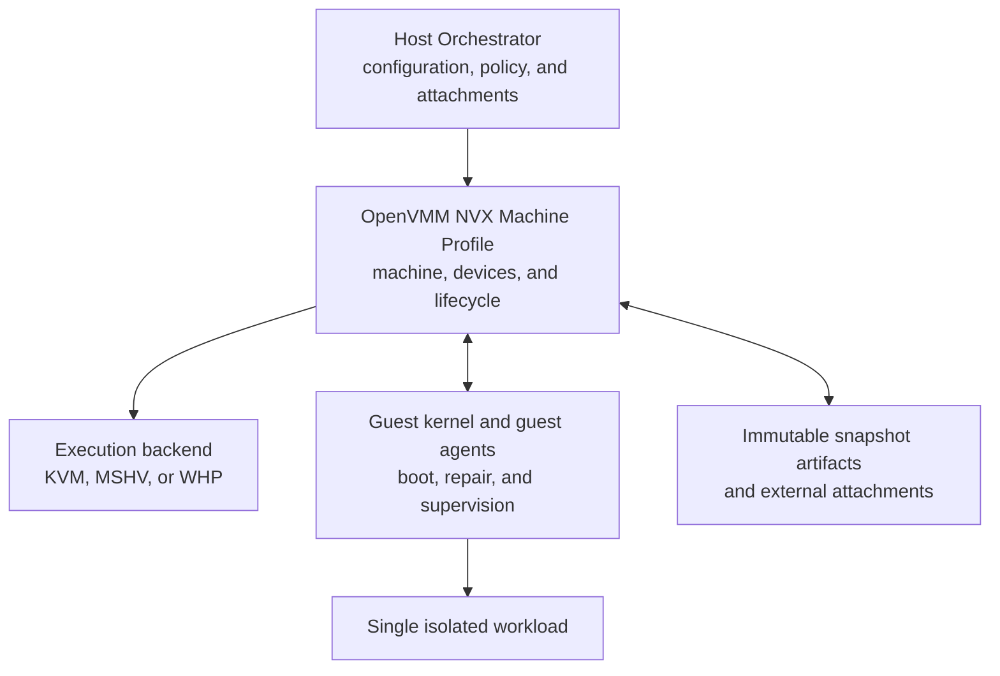

# Architecture Overview

[Architecture documentation](README.md)

NVX provides a small, versioned virtual machine for running Linux workloads on Linux or Windows
hosts (Figure 1.1). The guest-visible machine is owned by the NVX machine profile rather than
inferred from the selected hypervisor. KVM, MSHV, and WHP provide execution services, while the
machine profile defines one common boot, CPU, memory, device, time, and lifecycle contract.

This chapter introduces NVX's purpose, major architectural elements, trust boundaries, and
compatibility principles.

**Figure 1.1.** High-level view of the NVX architecture.

## Table of Contents

- [1.1 Goals](1.1-goals.md): Defines the properties the architecture provides.
- [1.2 Non-Goals](1.2-non-goals.md): Identifies the concerns outside the
  architecture's scope.
- [1.3 System Components and Responsibilities](1.3-system-components-and-responsibilities.md):
  Identifies the host, VMM, and guest components and assigns responsibility to
  each.
- [1.4 Trust Boundaries](1.4-trust-boundaries.md): Describes trusted and
  untrusted actors, sensitive data flows, and validation boundaries.
- [1.5 Compatibility and Versioning Model](1.5-compatibility-and-versioning-model.md):
  Explains how guest-visible contracts and persisted state evolve.
