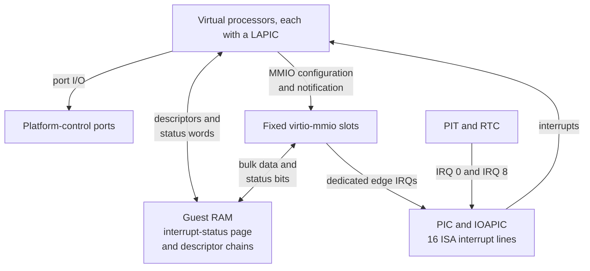

# 2.4 Interrupt and I/O Architecture

[Architecture documentation](README.md) >
[2. Virtual Machine Architecture](2-virtual-machine-architecture.md)

As Figure 2.2 shows, interrupts and I/O follow separate paths. Devices signal
interrupts on interrupt request lines (IRQs) of the PIC and IOAPIC, which
deliver them to each processor's local advanced programmable interrupt
controller (LAPIC). The LAPIC also provides a timer. Processors reach devices
through port I/O and MMIO, while bulk data and interrupt status move through
guest RAM.

**Figure 2.2.** Interrupt and I/O paths.

## 2.4.1 Architectural Devices

The base chipset contains exactly this allowlist:

- A generic PIC and IOAPIC.
- The selected backend's LAPIC.
- An i8253 PIT on IRQ 0.
- A generic programmable CMOS RTC anchored to UTC.
- The raw bidirectional byte channel.
- A status-carrying shutdown port.
- A guest snapshot-request port.

Serial UARTs, debug-console ports, Hyper-V power management, the legacy
joystick port (gameport), PCI, firmware helpers, and stubs that answer guest
accesses to absent legacy ports (standard-PC missing-port shims) are absent.

The RTC defaults to binary-coded decimal (BCD), 24-hour fields, with status
register B `0x02`. The PIC, IOAPIC, PIT, RTC, LAPIC, and VM time use common
device and state-unit machinery on every backend. IOAPIC saved state includes
the asserted level of every input line, and routing is reevaluated after
restore, so a level interrupt is neither lost nor treated as an edge while the
backend is reconstructed. The [time ABI](3.2-clock-and-time.md) defines the
behavior of the LAPIC timer, PIT, and RTC.

## 2.4.2 Interrupt Routing

The MP table describes processors, the ISA bus, the IOAPIC, and legacy IRQ
routing, and it routes only the 16 ISA interrupts. The machine profile uses no
ACPI interrupt tables. Dedicated virtio interrupts use active-high edge
delivery. No virtio device uses the RTC's exclusive IRQ 8, and no device uses
IRQ 9, 12, or 13 on any backend.

## 2.4.3 Port I/O

Port I/O serves the PIC, PIT, and CMOS RTC as well as the minimal
platform-control device. Table 2.5 lists the platform-control ports.

**Table 2.5.** Platform-control ports.

| Port | Function |
| ---: | --- |
| `0xe9` | Byte-channel data |
| `0xea` | Byte-channel status and record selector |
| `0xeb` | Time-sample window |
| `0x604` | Shutdown |
| `0x605` | Snapshot request and restore acknowledgement |

[Platform Control Device](3.1-platform-control-device.md) defines their
behavior.

## 2.4.4 Shared Interrupt Status

As Table 2.6 shows, each fixed virtio-mmio slot owns one little-endian,
naturally aligned 32-bit word in the reserved shared-status page.

**Table 2.6.** Shared interrupt-status words.

| Slot | Status GPA |
| --- | ---: |
| Network | `0x30000` |
| Host filesystem | `0x30004` |
| Boot console | `0x30008` |
| `distro` block | `0x3000c` |
| `scratch` block | `0x30018` |
| Control console | `0x3001c` |

A device publishes configuration-change and used-buffer bits with a
sequentially consistent compare-exchange loop and pulses its interrupt only
when the previous word was zero. The guest driver consumes every pending bit
with a sequentially consistent exchange to zero, so steady-state handling
performs no interrupt-status read or acknowledgement through MMIO. A device
update that races the exchange is either included in the exchanged value or
observes zero, stores its bit, and emits a new edge. Device reset and teardown
clear the word. Snapshot quiesce saves a pending value in transport state;
restore writes it back without replaying an edge, and the machine contract
records the interrupt mode, page address, and page size.

## 2.4.5 Data Movement

Device configuration and queue notification use MMIO. Bulk console, block,
network, and filesystem data move through descriptor chains in guest RAM
rather than through MMIO windows.
