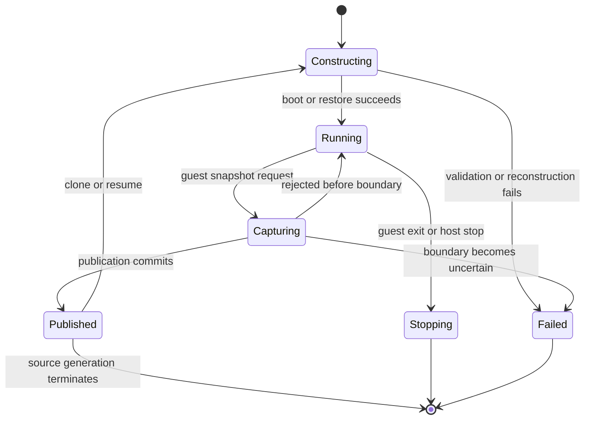

# VM Lifecycle and State

[Architecture documentation](README.md)

As Figure 5.1 shows, the VM lifecycle is a state machine with explicit
ownership and commit boundaries. Cold boot creates a new machine generation.
Snapshot terminates a generation after publishing immutable state. Restore
creates a new process generation from that state and reconstructs process-local
resources.

This chapter defines state transitions from creation through execution,
capture, restoration, and termination.

**Figure 5.1.** VM lifecycle states and transitions.

## Table of Contents

- [5.1 Boot Protocol](5.1-boot-protocol.md): Defines boot inputs, initial
  machine state, and kernel handoff.
- [5.2 Readiness and Runtime Control](5.2-readiness-and-runtime-control.md):
  Defines readiness boundaries and supported control operations.
- [5.3 Snapshot Protocol](5.3-snapshot-protocol.md): Defines capture initiation,
  quiescence, state collection, and publication.
- [5.4 Snapshot Artifact and Attachment Model](5.4-snapshot-artifact-and-attachment-model.md):
  Defines persisted artifacts, identity, sharing scope, and external resources.
- [5.5 Restore Protocol](5.5-restore-protocol.md): Defines admission,
  reconstruction, guest repair, entropy refresh, and return to execution.
- [5.6 Shutdown and Failure Semantics](5.6-shutdown-and-failure-semantics.md):
  Defines orderly exit, teardown, and terminal failure boundaries.
